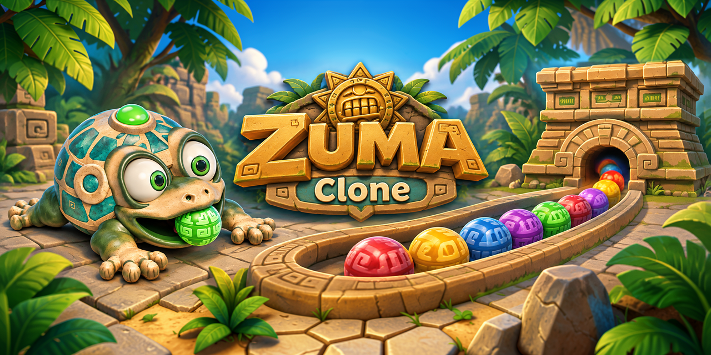

# Zuma Clone



https://github.com/user-attachments/assets/993a67fd-24f3-41da-877d-17d8ce7507d6

Zuma Clone is a 3D Unity recreation of the classic marble shooter. Aim the frog, match three or more marbles of the same color, and clear the chain before it reaches the temple gate.

## What you can play

- **Adventure** follows 25 levels across five themed chapters: Sandstone Temple, Moss & Jade Sanctuary, Bronze Ruins, Dark Stone Temple, and Volcanic Temple.
- **Gauntlet** offers Practice and Survival on unlocked maps, with a random-map option and score ranks.
- Shots slide into the chain before matches resolve. Matching ends can pull a split chain together and trigger another match. Combos, shots through gaps, coins, and time bonuses contribute to the score.
- The four power-ups are **Accuracy** (aiming guide), **Slowdown**, **Reverse**, and **Explosion**. Clear a match containing a marked marble to activate its effect.

## Run locally

1. Install **Unity 6000.5.3f1** in Unity Hub. Install Android Build Support with its SDK, NDK, and OpenJDK if you plan to build for Android.
2. Clone this repository and open its root folder as a Unity project. Let Unity resolve the packages and finish importing.
3. Open [`Initial.unity`](Assets/Scenes/Initial.unity) and enter Play Mode. The bootstrap scene initializes services and loads saved progress before routing to the menu or game.

| Action | Mouse | Touch |
| --- | --- | --- |
| Aim | Move the pointer across the playfield | Touch and drag on the playfield |
| Shoot | Left-click | Release the aiming finger over the playfield |
| Swap the loaded and spare marbles | Right-click | Tap the frog |

The [gameplay input configuration](Assets/Resources/StaticData/GameplayInputConfig.asset) defines the playable screen area. The input service also respects the device safe area and UI.

## Create or tune a level

Open **Tools → Level Editor**, select a chapter, and choose an existing level or click **Create**. Drag Bézier anchors and handles to reshape the road, Shift-click the road to insert an anchor, and drag the frog to move its spawn. Scroll to zoom, middle-drag to pan, and use **Fit map** to frame the route.

The editor saves each map as [level data](Assets/Resources/StaticData/Levels). At load time, [`LevelGeometryService`](Assets/Code/Services/Levels/LevelGeometryService.cs) applies that data to the shared [level prefab](Assets/Resources/Levels/Level.prefab). The chapter supplies the ground and track materials, and individual levels can override their textures. Selected maps also reference a [ground decoration prefab](Assets/ResourcesStatic/Prefabs/Game/GroundDecorations) that can be edited in Prefab Mode.

| To change | Open |
| --- | --- |
| Campaign order and chapter themes | [Chapter assets](Assets/Resources/StaticData/Chapters) and [theme assets](Assets/ResourcesStatic/Materials/LevelThemes) |
| Road, gates, frog, per-level goals, and power-up settings | [Level assets](Assets/Resources/StaticData/Levels) |
| Chain motion and spacing | [`BallChainConfig.asset`](Assets/Resources/StaticData/BallChainConfig.asset) |
| Ball appearances, level color selection, and scoring | [`BallConfig.asset`](Assets/Resources/StaticData/BallConfig.asset), [random configuration](Assets/Resources/StaticData/Random), and [score configuration](Assets/Resources/StaticData/Score) |
| Audio, vibration, localization, and save data | **Tools** in Unity for AudioVibrationKit, Localization Editor, and Save System Kit |

## Project structure

```text
Assets/
  Code/
    Infrastructure/       Bootstrap, dependency bindings, scene loading, game states, level editor
    Logic/Zuma/           Frog controls, projectile and chain-marble components, level objects
    Services/             Chain simulation, modes and progression, factories, pools, input, saves
    StaticData/           ScriptableObject types for the level catalog and gameplay settings
    UI/                   Menu, map selection, HUD, and in-game displays
    Window/               Window framework and win, lose, and bonus screens
    Localization/         Localization code
    Editor/               Audio, vibration, save, localization, animation, and test tools
    Extensions/           Shared extensions
    PathCreation/         Bézier paths, sampled vertex paths, and road mesh generation
  Resources/              Runtime prefabs, static data, and URP settings
  ResourcesStatic/        Materials, animations, models, sounds, effects, and map assets
  Scenes/                 Initial, Menu, and Game
  Shaders/                Custom shaders and third-party shader assets
  Plugins/                Bundled Unity plugins
  Tests/                  EditMode and PlayMode suites
Packages/                 Unity package manifest and dependency lockfile
ProjectSettings/          Unity version, enabled scenes, and project settings
Docs/                     Feature implementation notes and the Zuma Deluxe gameplay audit
Images/                   Repository artwork
.github/workflows/        Android CI workflow
```

### Where to start in the code

| Area | Entry points |
| --- | --- |
| Boot and scene flow | [`BootstrapInstaller`](Assets/Code/Infrastructure/Installers/BootstrapInstaller.cs), [game states](Assets/Code/Infrastructure/StateMachine/Game/States), [`LoadLevelState`](Assets/Code/Infrastructure/StateMachine/Game/States/LoadLevelState.cs) |
| Aim, shoot, and swap | [`PlayerAiming`](Assets/Code/Logic/Zuma/Players/PlayerAiming.cs), [`PlayerShooting`](Assets/Code/Logic/Zuma/Players/PlayerShooting.cs), [input devices](Assets/Code/Services/Input/Device) |
| Chain movement, insertion, matches, and combos | [`BallChainController`](Assets/Code/Services/BallController/BallChainController.cs), [`AttachingBallChainHandler`](Assets/Code/Services/BallController/AttachingBallChainHandler.cs) |
| Level loading and progression | [Level services](Assets/Code/Services/Levels), [runtime resource paths](Assets/Code/Services/Factories/ResourcePath.cs), [persistence and save services](Assets/Code/Services/SaveLoad) |
| Authoring tools | [Level Editor](Assets/Code/Infrastructure/Editor/LevelEditor) and [other Unity editor tools](Assets/Code/Editor) |

## Tech stack

Unity 6000.5.3f1 · URP 17.5.0 · C# · Extenject for dependency injection · UniTask for async flow · DOTween for animation · uGUI for runtime UI · UI Toolkit for the Level Editor · PathCreator for splines · ParticleEffectForUGUI for UI particles.

## Tests and development notes

Run the [EditMode and PlayMode tests](Assets/Tests) from **Window → General → Test Runner**, or open **Tools → Tests Tool Window**. The suites cover core ball-chain behavior, level services, asset and scene checks, and runtime providers.

- [Feature implementation notes](Docs/Features)
- [Zuma Deluxe reference and gameplay audit](Docs/ZumaDeluxe)
- [Project conventions and Unity commands](AGENTS.md) · [Claude Code guidance](CLAUDE.md)
