# 🎯 Zuma Clone
**ZumaClone** is a Unity-powered remake of the classic arcade *Zuma*.  
It features dynamic shooting mechanics, match-3 ball destruction, smooth spline-based movement, and full win/lose conditions.

### 🎞️ Gameplay GIFs
<table>
  <tr>
    <td align="center">
      
      <p style="font-weight: bold; margin-top: 6px;"></p>
    </td>
    <td align="center">
      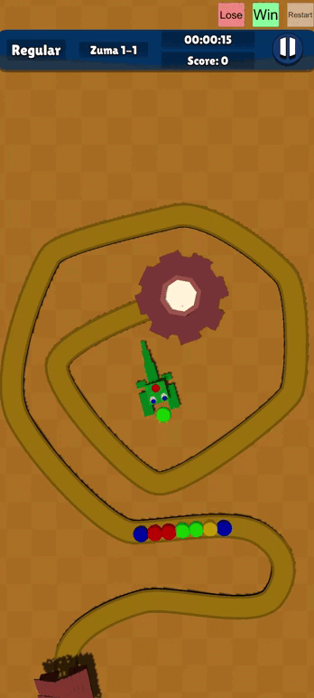
      <p style="font-weight: bold; margin-top: 6px;"></p>
    </td>
    <td align="center">
      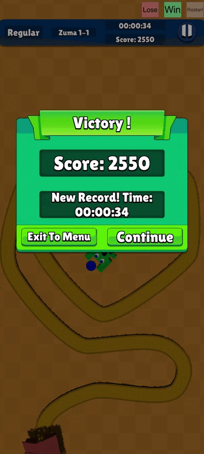
      <p style="font-weight: bold; margin-top: 6px;"></p>
    </td>
  </tr>
  <tr>
    <td align="center">
      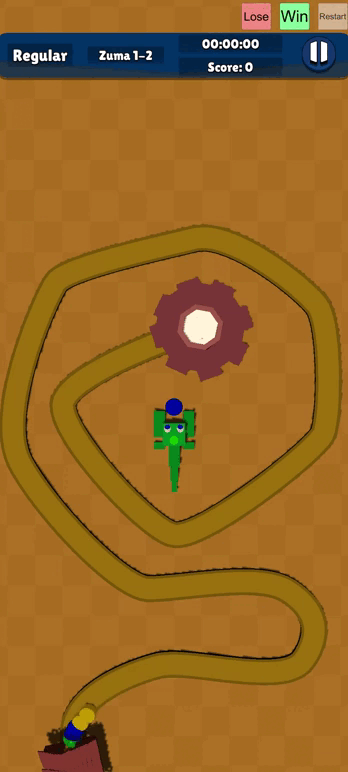
      <p style="font-weight: bold; margin-top: 6px;"></p>
    </td>
    <td align="center">
      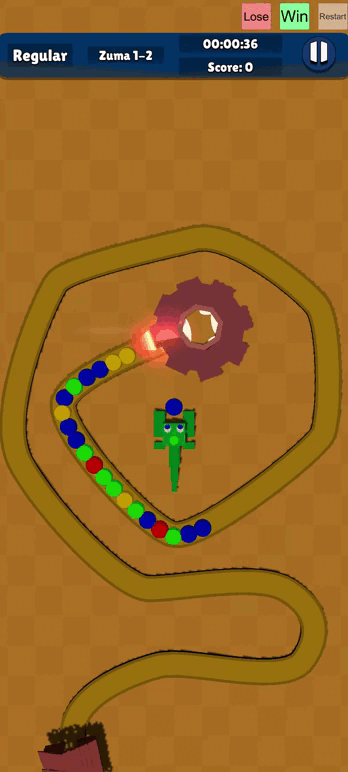
      <p style="font-weight: bold; margin-top: 6px;"></p>
    </td>
    <td align="center">
      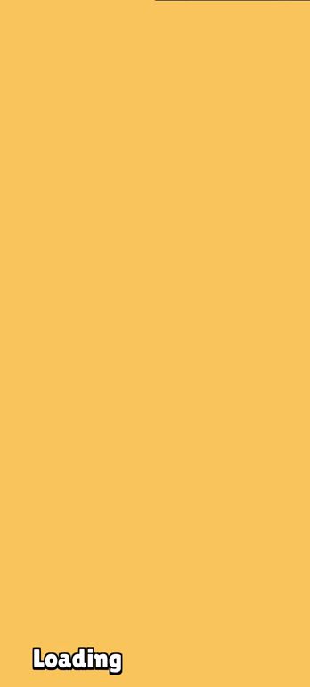
      <p style="font-weight: bold; margin-top: 6px;"></p>
    </td>
  </tr>
</table>

<!--
### 🖼️ Screenshots
<table>
  <tr>
    <td>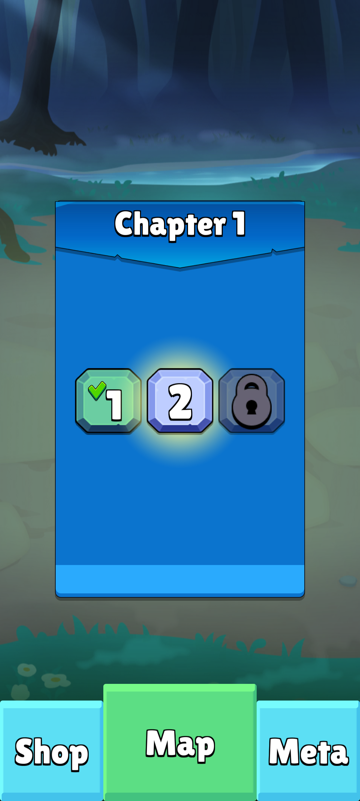</td>
    <td>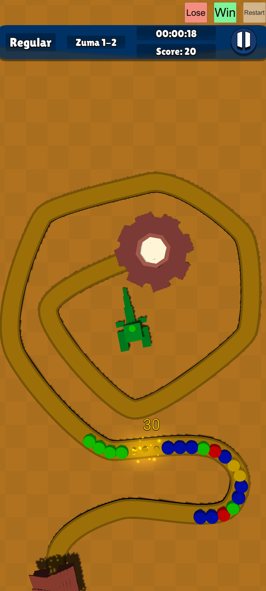</td>
    <td>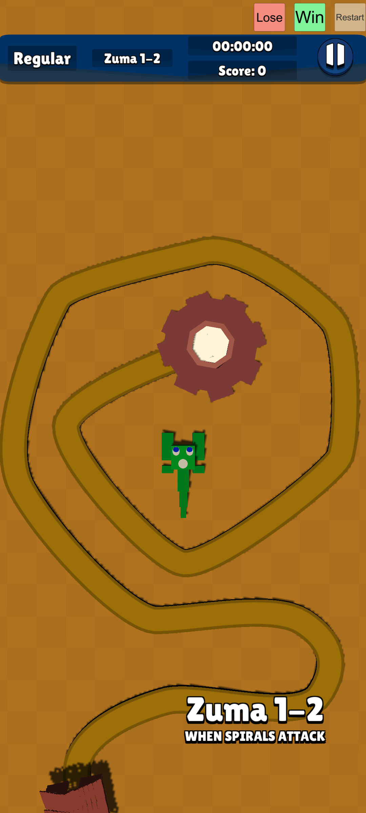</td>
  </tr>
  <tr>
    <td>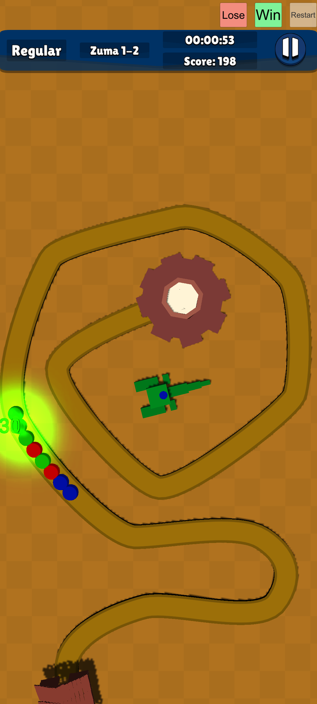</td>
    <td>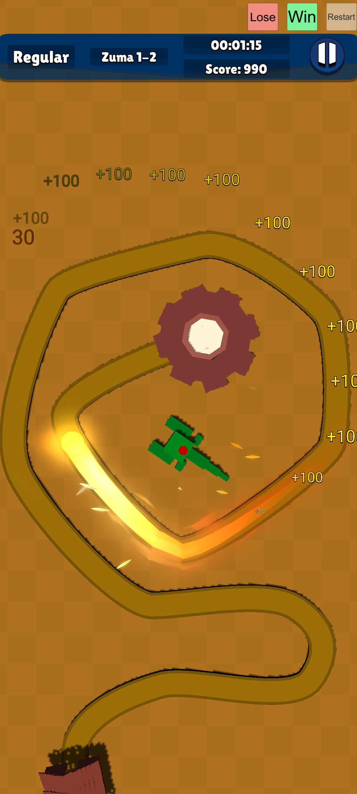</td>
    <td>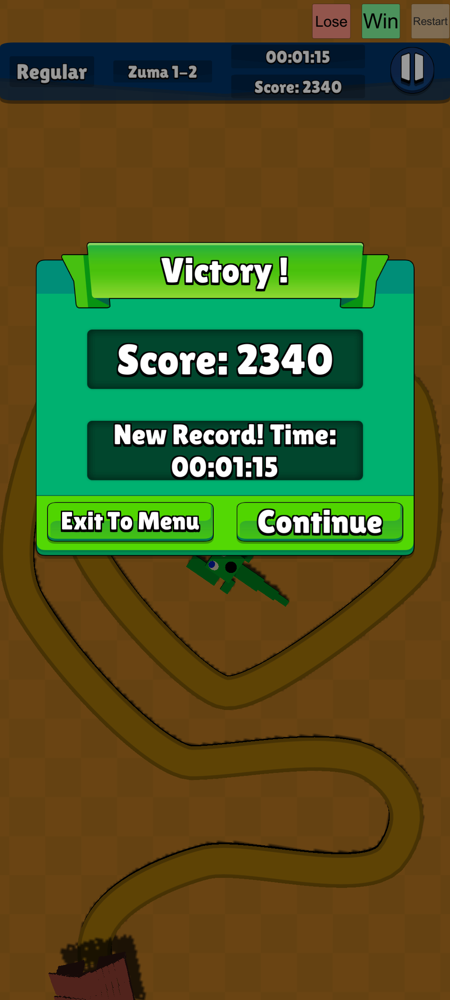</td>
  </tr>
</table>
-->

### ⚙️ Features
- Shoot balls and switch between them mid-game  
- Match-3 mechanic with automatic chain destruction  
- Smooth snake movement along spline curves (PathCreator)  
- Win and lose conditions with endgame triggers  
- Reload animations and shooting cooldown  
- Full support for Unity URP and modern asset workflows  
- Clean architecture using Zenject and async handling via UniTask  
- In-editor tools for localization, audio, saves, and tests

### 🧰 Tech Stack

- **Unity 6000.5.3f1** with **URP 17.5.0**
- **Extenject (Zenject)** – Dependency injection
- **DOTween** – Animation system
- **UniTask** – Async/await support for Unity
- **uGUI** – Runtime UI
- **PathCreator** – Spline movement system
- **ParticleEffectForUGUI** – UI-friendly particle support

## Project structure

```text
Assets/
  Code/
    Infrastructure/          Bootstrap, dependency bindings, scene loader, game states
    Logic/Zuma/              Player aiming and shooting, ball components, level objects
    Services/
      BallController/        Ball chains, insertion, matches, combos, and end-of-chain behavior
      Levels/                Chapter and level selection and progression
      LocalProgress/         Score for the current level
      PersistenceProgress/   Player data used across sessions
      SaveLoad/              PlayerPrefs, JSON, and XML save backends
      Factories/             Gameplay and UI factories and Resources path constants
    StaticData/              ScriptableObject types for gameplay configuration
    UI/                      Game HUD and menu windows
    Window/                  Shared window types and implementations
    Editor/                  Localization, audio, save, and test tools
    Extensions/              Shared C# extension methods
    PathCreation/            PathCreator spline runtime and examples
  Scenes/                    Initial.unity, Menu.unity, and Game.unity
  Resources/                 Runtime prefabs for balls, players, levels, HUDs, and UI
    StaticData/              Game settings, chapters, levels, scores, and audio data
    URP/                     Render pipeline and renderer assets
  ResourcesStatic/           Animations, models, and effects referenced by assets
  Shaders/                   Shader assets and supporting scripts
  Tests/
    EditMode/                Service, scene, prefab, and configuration checks
    PlayMode/                Runtime and widget provider checks
Packages/                    Unity package manifest and dependency lock file
ProjectSettings/             Pinned Unity version, build scenes, and project settings
AGENTS.md                    Project guidance for Codex
CLAUDE.md                    Project guidance for Claude Code
```

### Where to start

| Task | Start here |
|---|---|
| Run the game | Open [`Initial.unity`](Assets/Scenes/Initial.unity) in Unity and enter Play Mode. Startup loads the first level or opens the menu based on saved progress. |
| Trace startup or scene changes | Start with [`BootstrapInstaller`](Assets/Code/Infrastructure/Installers/BootstrapInstaller.cs) and the [game states](Assets/Code/Infrastructure/StateMachine/Game/States). [`SceneLoader`](Assets/Code/Infrastructure/SceneLoader.cs) loads scenes from [Build Settings](ProjectSettings/EditorBuildSettings.asset). |
| Change aiming, shooting, or ball chains | Start with [`PlayerAiming`](Assets/Code/Logic/Zuma/Players/PlayerAiming.cs), [`PlayerShooting`](Assets/Code/Logic/Zuma/Players/PlayerShooting.cs), or [`BallChainController`](Assets/Code/Services/BallController/BallChainController.cs). Match and combo handling lives in [`AttachingBallChainHandler`](Assets/Code/Services/BallController/AttachingBallChainHandler.cs). |
| Tune a level, chain, or score | Use the [chapter definitions](Assets/Resources/StaticData/Chapters), [level definitions](Assets/Resources/StaticData/Levels), [`BallChainConfig.asset`](Assets/Resources/StaticData/BallChainConfig.asset), and [score settings](Assets/Resources/StaticData/Score). |
| Find a runtime prefab | Check [`ResourcePath`](Assets/Code/Services/Factories/ResourcePath.cs) for the paths used by factories and look under [`Assets/Resources`](Assets/Resources). |
| Run tests or work with an agent | Open Unity’s **Window → General → Test Runner** for the [EditMode and PlayMode suites](Assets/Tests). See [`AGENTS.md`](AGENTS.md) or [`CLAUDE.md`](CLAUDE.md) for project conventions and live Editor commands. |
